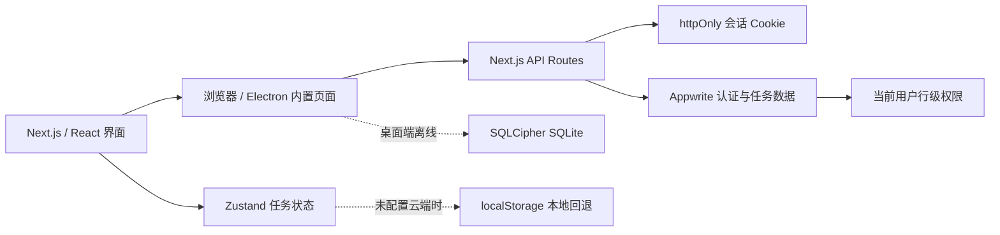

# TaskFlow

> 一个围绕个人当下规划和下一步行动设计的个人任务工作台。

<p align="center">
  <a href="https://www.uta4k.top/"></a>
  <a href="https://github.com/Uonlra/TaskFlow"></a>
  <a href="LICENSE"></a>
  
  
  
</p>

TaskFlow 将任务记录、截止风险、进度统计和可恢复筛选汇集到一个轻量工作台中。它面向需要持续处理学习、工作和个人事务的用户：打开页面即可知道今天该做什么、哪些事项即将到期，以及整体推进情况。

**在线预览：** [www.uta4k.top](https://www.uta4k.top/)

**项目主页：** [github.com/Uonlra/TaskFlow](https://github.com/Uonlra/TaskFlow)

## 项目亮点

- TaskFlow 不把任务仅仅当作静态条目。系统会结合截止日期、完成状态和优先级，为今天到期、未来三天到期和逾期任务提供清晰提示；总览、日历和统计页从不同视角帮助用户判断下一步工作重点。

- 任务页与总览页会将关键筛选条件和时间范围同步到 URL。刷新页面、复制链接或在不同页面间往返时，当前工作视图不会丢失，适合将任务列表作为持续使用的工作界面。

- 桌面端提供适合扫描、筛选和批量查看的工作台布局；移动端则收紧信息层级，统一日期切换和快捷筛选操作，让查看今日事项与临近任务保持直接。

- 配置 Appwrite 后，项目提供邮箱认证和真实任务数据同步；没有后端公共配置时，任务状态自动回退至 `localStorage`，便于本地体验和快速演示。

- 浏览器只与 Next.js API Routes 通信，Appwrite API Key 保留在服务端。会话通过 `httpOnly` Cookie 保存，任务表的行级权限限制为当前用户自身数据，从架构上缩小客户端暴露面。

## 功能一览

- 邮箱注册、登录、退出和会话保持
- 创建、编辑、删除、完成及查看任务详情
- 通过关键词、标签、状态、优先级和排序规则定位任务
- 任务快捷筛选：今天、临近截止、未完成、已完成
- 总览统计、完成趋势、状态与标签分布、近期活动
- 逾期、当天到期及未来三天截止提醒
- 日历视图与个人资料设置
- Appwrite 云端数据与 `localStorage` 本地回退

## 架构概览



## 技术栈

| 范畴       | 选型                                                  |
| ---------- | ----------------------------------------------------- |
| 应用框架   | Next.js 16（App Router）、React 19、TypeScript 6      |
| 表单与状态 | React Hook Form、Zod、Zustand                         |
| 数据与认证 | Appwrite、Next.js API Routes、`httpOnly` Cookie       |
| 可视化     | ECharts、anime.js                                     |
| 质量保障   | Vitest、Testing Library、Playwright、ESLint、Prettier |
| 包管理     | pnpm 10.7.0                                           |

## 快速开始

### 环境要求

- Node.js 22 或更高版本
- pnpm 10.7.0（建议通过 Corepack 启用）

### 安装与启动

```bash
corepack enable
pnpm install
Copy-Item .env.example .env.local
pnpm dev
```

启动后访问 [http://localhost:3000](http://localhost:3000)。在 PowerShell 中使用上述复制命令；macOS 或 Linux 可改为：

```bash
cp .env.example .env.local
```

### 配置 Appwrite（可选）

将以下值填入 `.env.local`，即可启用真实账户和任务数据：

```dotenv
NEXT_PUBLIC_APPWRITE_ENDPOINT=https://sgp.cloud.appwrite.io/v1
NEXT_PUBLIC_APPWRITE_PROJECT_ID=xxx
APPWRITE_API_KEY=xxx
APPWRITE_DATABASE_ID=xxx
APPWRITE_TASKS_TABLE_ID=xxx
APPWRITE_SESSION_COOKIE_NAME=taskflow-session
NEXT_PUBLIC_SITE_URL=http://localhost:3000
```

`APPWRITE_API_KEY` 仅供服务端使用，绝不能添加 `NEXT_PUBLIC_` 前缀，也不应提交到版本库。未配置 Appwrite 的公开变量时，应用将以本地存储模式运行。

在 Appwrite 中创建 `tasks` 表后，请启用 Row Security，并确保每条任务仅授予创建者读、更新和删除权限。

## 常用命令

| 命令                     | 用途                                      |
| ------------------------ | ----------------------------------------- |
| `pnpm dev`               | 启动开发服务器                            |
| `pnpm build`             | 生成生产构建                              |
| `pnpm start`             | 启动生产服务器                            |
| `pnpm lint`              | 执行代码检查                              |
| `pnpm format:check`      | 检查格式                                  |
| `pnpm typecheck`         | 执行 TypeScript 类型检查                  |
| `pnpm test`              | 运行单元与组件测试                        |
| `pnpm test:coverage`     | 生成测试覆盖率                            |
| `pnpm test:e2e:mock`     | 运行 Mock 端到端测试                      |
| `pnpm electron:dev`      | 启动 Next.js 并在 Electron 桌面窗口中打开 |
| `pnpm desktop:web-build` | 构建 Electron 内置的静态页面资源          |
| `pnpm desktop:pack`      | 生成 Windows x64 未安装目录               |
| `pnpm desktop:dist`      | 生成 Windows x64 NSIS 安装包              |

### Electron 桌面端

开发时运行 `pnpm electron:dev`，它会同时启动 Next.js 开发服务器和 Electron 窗口。发布包先运行 `pnpm desktop:web-build`，再运行打包命令；发布包内置静态页面资源，可以在无网络时启动总览、任务、详情、日历、统计和设置页面。

打包版本默认使用 `app://taskflow/` 加载本地页面资源，任务和认证接口仍通过 `https://www.uta4k.top/` 的 Next.js API Routes 访问。设置 `TASKFLOW_WEB_URL` 或 `ELECTRON_START_URL` 可以临时覆盖启动地址。桌面包不会把包含服务端密钥的 Next.js 服务端代码打进客户端。

Windows x64 安装包由 electron-builder 生成，发布配置指向 GitHub Releases。自动更新接入会在远程 API 和本地离线存储稳定后进入第二批桌面端工作。

离线数据层已采用 SQLCipher SQLite。数据库文件保存在 Electron 的 `userData` 目录，随机数据库密钥由 Windows DPAPI 通过 Electron `safeStorage` 保护。首次在线登录后，远端任务会导入本地缓存；之后任务创建、编辑、完成和删除通过受信任来源校验的 preload IPC 写入本地数据库，并记录同步队列。联网后，桌面端通过 `POST /api/tasks/sync` 批量回放队列，同一任务仅发送最新快照；服务端按客户端逻辑编辑时间判断桌面回放冲突，并将冲突时的远端版本回传给本地缓存。回放会在登录初始化、恢复联网和定时同步时触发，失败操作保留并记录重试次数。托盘、快捷键和通知属于后续批次。

部署同步 API 前，在 Appwrite 任务表中新增可选 `datetime` 字段 `syncClientUpdatedAt`，或运行 `pnpm appwrite:ensure-task-sync-column`（需要具有数据库结构写入权限的 `APPWRITE_API_KEY`）。确认字段状态为 `available` 后再部署代码；此字段用于区分桌面端离线编辑时间与 Appwrite 处理请求的时间。已有任务无需回填，缺少该字段时按 Appwrite 的 `$updatedAt` 比较。

## 质量保障

项目的 GitHub Actions 会在推送和拉取请求中自动执行 lint、格式检查、单元与组件测试、类型检查、生产构建及 Mock E2E 测试。

桌面端补充验证包括：桌面静态页面导出、Electron 主进程脚本语法检查、SQLCipher 本地导入与离线创建 smoke test，以及 `pnpm typecheck`。

## 项目结构

```txt
src/
  app/                  # App Router 页面与 API Routes
  features/             # auth、tasks、dashboard、calendar、settings、stats 等业务域
  shared/               # 跨业务组件、hooks、providers 与工具函数
  styles/               # 全局及页面样式

test/                   # 单元、组件与端到端测试
docs/screenshots/       # README 界面截图
```

## 路由

| 路径                    | 页面                 |
| ----------------------- | -------------------- |
| `/`                     | 应用入口             |
| `/login`、`/register`   | 登录与注册           |
| `/dashboard`            | 任务总览             |
| `/tasks`、`/tasks/[id]` | 任务工作台与任务详情 |
| `/calendar`             | 日历视图             |
| `/stats`                | 统计分析             |
| `/settings`             | 个人设置             |

## 参与贡献

欢迎通过 Issue 报告问题或提出改进建议。提交 Pull Request 前，请确保以下命令均能通过：

```bash
pnpm lint
pnpm format:check
pnpm test
pnpm typecheck
pnpm build
```

请保持提交内容一次一类，并为行为变更补充相应测试。

## 贡献提交

相关提交风格遵循：[约定式提交](https://www.conventionalcommits.org/zh-hans/v1.0.0/)

## 许可证

本项目基于 [MIT License](LICENSE) 开源。
